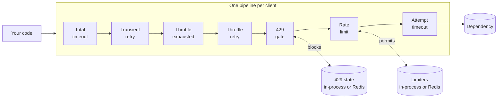

# HTTP resilience in .NET — a working playbook

Retries, timeouts and outbound throttling for `HttpClient`, built on `Microsoft.Extensions.Http.Resilience`
and Polly — for services that call dependencies they do not control, under limits they did not set. A
small library, tests that run on a fake clock, a runnable demo, and documentation that explains each
design decision and how to apply it to your own solution.



## Why not the standard handler?

`AddStandardResilienceHandler()` is a good default for an interactive request that must answer in
seconds. It falls short when:

- **the dependency throttles.** A `Retry-After: 60` does not fit in a 30-second total timeout, and 429s
  use up the same retry budget as server errors;
- **a request is not safe to repeat.** It retries a `POST` that timed out on the client but succeeded on
  the server;
- **many clients, or many instances, share one limit.** Each client counts on its own, and one instance
  learning about a 429 does not hold back the others;
- **the caller is a background worker.** It needs to know that throttling — not a failure — ended the
  call, so it can defer the work instead of dead-lettering it.

This playbook covers those cases.

## What it shows

| Topic | Read | See it in code |
|---|---|---|
| The pipeline: which strategy, in which order, and why | [architecture.md](docs/architecture.md) | [PipelineComposer.cs](src/HttpResilience/Strategies/PipelineComposer.cs) |
| An attempt timeout, and a total timeout computed from the retries | [timeouts.md](docs/timeouts.md) | [HttpResilienceOptions.cs](src/HttpResilience/HttpResilienceOptions.cs) |
| Retrying transient failures, only when the request is safe to repeat | [transient-retries.md](docs/transient-retries.md) | [TransientRetry.cs](src/HttpResilience/Strategies/TransientRetry.cs) |
| Honouring `Retry-After`, and sharing a 429 with every client of the same dependency | [throttling-and-retry-after.md](docs/throttling-and-retry-after.md) | [ThrottleRetry.cs](src/HttpResilience/Strategies/ThrottleRetry.cs), [ThrottleGateStrategy.cs](src/HttpResilience/Strategies/ThrottleGateStrategy.cs) |
| Enforcing a dependency's rate limit before it does, per host and path | [rate-limit-rules.md](docs/rate-limit-rules.md) | [ThrottleRuleMatcher.cs](src/HttpResilience/Throttling/ThrottleRuleMatcher.cs), [RateLimitStrategy.cs](src/HttpResilience/Strategies/RateLimitStrategy.cs) |
| One limit and one 429 state across instances, with Redis | [distributed-throttling-with-redis.md](docs/distributed-throttling-with-redis.md) | [LuaScripts.cs](src/HttpResilience.Redis/LuaScripts.cs), [RedisRateLimiter.cs](src/HttpResilience.Redis/RedisRateLimiter.cs) |
| Options from configuration and code, validation and reloads | [configuration.md](docs/configuration.md) | [HttpClientBuilderExtensions.cs](src/HttpResilience/HttpClientBuilderExtensions.cs) |
| Metrics, logs and traces | [observability.md](docs/observability.md) | [HttpResilienceMetrics.cs](src/HttpResilience/HttpResilienceMetrics.cs), [Log.cs](src/HttpResilience/Log.cs) |
| Testing time-based behaviour on a fake clock, and against a real Redis | [testing.md](docs/testing.md) | [TestHost.cs](tests/HttpResilience.Tests/Pipeline/TestHost.cs), [RedisServer.cs](tests/HttpResilience.Redis.Tests/RedisServer.cs) |
| HTTP retries next to message redelivery, scheduled retries and a circuit breaker | [layered-retries.md](docs/layered-retries.md) | [HttpResilienceRequestOptions.cs](src/HttpResilience/HttpResilienceRequestOptions.cs) |

Then: [get started](docs/getting-started.md), [migrate](docs/migration.md) from what you have,
[apply it to your own solution](docs/applying-to-your-solution.md), and read the
[pitfalls](docs/pitfalls.md) first.

## Quick start

Requires the .NET 10 SDK. Docker is optional: without it, the tests that need Redis are skipped.

```shell
dotnet test HttpResilience.slnx
dotnet run --project samples/PartnerDemo
```

The demo calls a simulated dependency that fails, throttles and hangs, and prints what the pipeline
did. To run the Redis tests against a Redis you already have, set
`REDIS_CONNECTION_STRING=localhost:6379`. See [getting started](docs/getting-started.md).

## Layout

```text
src/
  HttpResilience/          The pipeline: timeouts, retries, the 429 gate, rate limits, options, metrics, logs
  HttpResilience.Redis/    Optional: rate limiters and 429 state shared across instances, in Redis
samples/
  PartnerDemo/             A console app against a simulated dependency
tests/
  HttpResilience.Tests/        The pipeline end to end on a fake clock, and every building block
  HttpResilience.Redis.Tests/  The Lua limiters, the shared 429 state and the failure modes, against a real Redis
tools/                     Leak check and documentation link check, run in CI
```

## Related playbooks

From the same monorepo, each on its own:

- [Circuit breakers on Azure Functions](https://github.com/iverburgh/azure-functions-circuit-breaker-playbook) —
  a breaker shared by every instance: the layer above these retries when a dependency is down.
- [Azure App Configuration](https://github.com/iverburgh/azure-app-configuration-playbook) —
  configuration as code, including the timeouts and limits per environment.
- [Domain-Driven Design in .NET](https://github.com/iverburgh/ddd-dotnet-playbook) — bounded
  contexts, domain events and the outbox: the integration that calls these dependencies.
- [Entra ID app registrations as code](https://github.com/iverburgh/entra-app-registrations-as-code-playbook) —
  app registrations, roles and access as code, such as the tokens these clients send.
- [Copilot on Azure DevOps](https://github.com/iverburgh/copilot-azure-devops-playbook) —
  instructions, skills and agents for a repository like this one.
- [Path filters on Azure DevOps](https://github.com/iverburgh/azure-devops-path-filter-playbook) —
  build and deploy only what a change touches.
- [Renovate on Azure DevOps](https://github.com/iverburgh/renovate-azure-devops-playbook) —
  automated dependency updates.
- [OpenTelemetry observability in .NET](https://github.com/iverburgh/dotnet-opentelemetry-observability-playbook) —
  traces, metrics and logs with OpenTelemetry and Application Insights, where these clients' metrics
  end up.

## License

[MIT](LICENSE)
