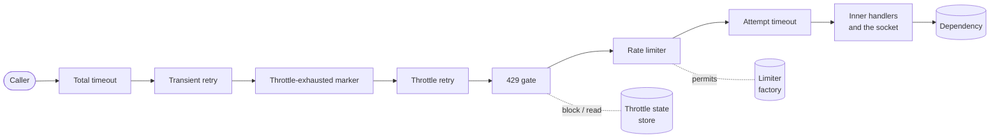

# Architecture

One `DelegatingHandler`, added with `AddHttpResilience()`, runs every outgoing request through a Polly
pipeline of seven strategies. This page explains the order, because the order *is* the design: move one
strategy and a different set of failures is retried, counted or cut off.

## The pipeline

From the outside in:

| # | Strategy | Does | Why here |
|---|---|---|---|
| 1 | **Total timeout** | Cancels the whole call, retries and waits included. | The caller's patience; nothing outside it. |
| 2 | **Transient retry** | Retries network errors, timeouts, 5xx and 408, with exponential backoff and jitter. Only for requests that are [safe to send twice](transient-retries.md#idempotency). | Outside the throttle strategies, so a 429 never spends a transient retry. |
| 3 | **Throttle-exhausted marker** | Sees the *final* throttling outcome: marks the request, counts it once. | Just outside the throttle retry, so it only sees what the throttle retry gave up on. |
| 4 | **Throttle retry** | Retries a 429 or a local rejection after the wait the server or limiter named. | Inside the transient retry: throttling is a separate budget with a separate clock. |
| 5 | **429 gate** | Refuses requests to a dependency that recently answered 429; records new 429s. | Inside the throttle retry, so each throttle retry checks it again. |
| 6 | **Rate limiter** | Takes a permit from the dependency's limiter before each attempt. | Inside the gate: a blocked dependency does not consume permits. Outside the attempt timeout: waiting for a permit is not the dependency's slowness. |
| 7 | **Attempt timeout** | Cancels one attempt. | Innermost, so each attempt gets the full time. |

Code: [PipelineComposer.cs](../src/HttpResilience/Strategies/PipelineComposer.cs).

## What the caller sees

| Outcome | How it reaches the caller | Request marked exhausted |
|---|---|---|
| Success, or a non-transient status (400, 404, …) | the response | no |
| Transient failure after all retries | the last response (5xx) or exception (`HttpRequestException`, `TimeoutRejectedException`) | no |
| Total timeout | `TimeoutRejectedException` | no |
| The dependency kept answering 429 | the last 429 response | yes |
| The limiter or the gate kept refusing | `OutboundThrottleRejectedException` with `Reason`, `ScopeKey` and `RetryAfter` | yes |

`OutboundThrottleRejectedException` and `TimeoutRejectedException` both derive from Polly's
`ExecutionRejectedException`. "Exhausted" means `request.IsThrottleExhausted()` returns `true`; an outer
retry of your own — a message redelivery, for example — can use it to back off longer. See
[layered retries](layered-retries.md).

## Two pipelines

| Extension | Strategies | For |
|---|---|---|
| `AddHttpResilience()` | all seven | almost every client |
| `AddOutboundThrottling()` | 3–6: marker, throttle retry, gate, limiter | a client that keeps its own timeouts and retries, but must respect the shared rate limits and 429s |

`AddHttpResilience` sets `HttpClient.Timeout` to infinite, because the pipeline owns time: the default
100 seconds would otherwise cut through retries. `AddOutboundThrottling` leaves it alone — see
[timeouts](timeouts.md#the-throttling-only-pipeline).

## Shared parts

Some things belong to the *dependency*, not to a client registration. Two clients calling the same API
share its rate limit and its 429s. These are singletons, registered once:

| Service | Default | Replace with |
|---|---|---|
| `ThrottleRuleMatcher` | rules from `OutboundThrottlingOptions` | — |
| `IRateLimiterFactory` | in-process limiters (`System.Threading.RateLimiting`) | [Redis limiters](distributed-throttling-with-redis.md) |
| `IThrottleStateStore` | in-memory 429 blocks | [Redis store](distributed-throttling-with-redis.md) |
| `TimeProvider` | `TimeProvider.System` | `FakeTimeProvider` in [tests](testing.md) |

A request is matched to a **throttle scope** once, at the first strategy that needs it, and the scope is
kept on the Polly context for every retry. A scope is a host plus an optional path prefix:
`api.partner.example/orders`. See [rate-limit rules](rate-limit-rules.md).

## Fail open

Everything the pipeline adds on top of plain retries is there to protect the dependency. When that
protection itself fails — the store throws, the limiter backend is down — the request goes through and
the failure is logged and counted (`resilience.http.store.failures`). Losing a rate limit for a few
minutes is better than losing every outgoing call. The Redis limiters can be switched to
[fail closed](distributed-throttling-with-redis.md#when-redis-is-down).

## Where the handler sits

The resilience handler sits where you call `AddHttpResilience()` among other `AddHttpMessageHandler`
calls. Call it first to make it outermost: then a retry runs every inner handler again, which is what you
want for a handler that adds a bearer token. See
[transient retries](transient-retries.md#retrying-with-a-fresh-token).

## Not included

- **Circuit breaker.** In-process breakers know too little when many instances call one dependency. See
  the [circuit breaker playbook](https://github.com/iverburgh/azure-functions-circuit-breaker-playbook)
  and [layered retries](layered-retries.md).
- **Hedging.** Sending a second copy of a slow request doubles the load on a dependency that is already
  slow, and is only safe for idempotent reads. Add Polly's hedging strategy yourself where it fits.
