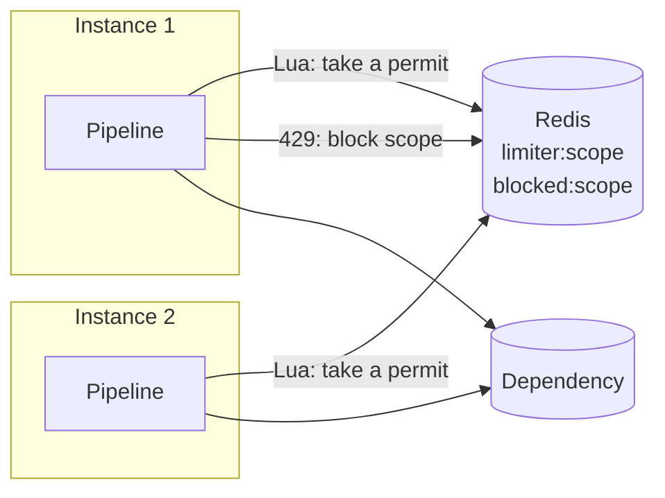

# Distributed throttling with Redis

In-process limiters and 429 blocks cover one process. With three instances, a limit of 20 per second
becomes 60, and a 429 seen by one instance is news to the other two. `HttpResilience.Redis` moves both
to Redis, so every instance shares one budget and one memory of 429s.



## Do you need it?

Not by default. Start in-process; move to Redis when one of these is true:

- the dependency's limit is **global** for your credentials, and you run more than one instance;
- you **autoscale**, so dividing the limit by the instance count does not work;
- the dependency **punishes** 429s — a quota penalty, a temporary ban — so every instance learning on its
  own is too expensive.

Redis adds a round trip to every attempt that has a limit, and a dependency you have to run.

## Registration

```csharp
builder.Services.AddOutboundThrottlingRules(builder.Configuration.GetSection("OutboundThrottling"));
builder.Services.AddHttpResilienceRedis(builder.Configuration.GetSection(RedisThrottlingOptions.SectionName));
```

```json
{
  "HttpResilience": {
    "Redis": {
      "Endpoint": "my-cache.redis.cache.windows.net:6380",
      "KeyPrefix": "orders-service",
      "LimiterFailureMode": "AllowRequests",
      "ConcurrencyLeaseTimeout": "00:05:00"
    }
  }
}
```

It replaces the in-memory store and limiter factory, whether it is called before or after
`AddHttpResilience`. Nothing changes in the clients.

### Connecting

Exactly one of:

| Option | For |
|---|---|
| `ConnectionString` | a local Redis, or a cache with an access key (keep it in a secret store) |
| `Endpoint` | Azure Cache for Redis / Azure Managed Redis with Microsoft Entra ID: signs in with `Credential`, or `DefaultAzureCredential` when empty. No secret at all. |
| a registered `IConnectionMultiplexer` | an app that already has a connection; it is reused |

Prefer `Endpoint` with a managed identity. Give that identity a data-access policy on the cache that
allows the commands below and nothing more.

The connection is opened on first use. If that fails, the next call tries again, and in the meantime the
[failure mode](#when-redis-is-down) applies. Startup does not depend on Redis being up.

## Keys

| Key | Holds | Expires |
|---|---|---|
| `{KeyPrefix}:limiter:{scope}` | the limiter state for one throttle scope | after its window, period or lease |
| `{KeyPrefix}:blocked:{scope}` | until when the scope is blocked after a 429 | at that moment |

`{scope}` is the [throttle scope](rate-limit-rules.md#matching) key, for example
`api.partner.example/orders`. Give each application its own `KeyPrefix` when they share a cache —
unless they share the dependency's quota too, in which case sharing the prefix is the point.

## Algorithms in Redis

Each check-and-update is one Lua script, so it is atomic and costs one round trip
([LuaScripts.cs](../src/HttpResilience.Redis/LuaScripts.cs)):

| Algorithm | Redis structure | Notes |
|---|---|---|
| `FixedWindow` | a counter with `INCR` and a TTL of one window | cheapest |
| `SlidingWindow` | a sorted set of request timestamps | an exact rolling window, not the segmented approximation of the in-process limiter; `SegmentsPerWindow` is ignored. Memory grows with `PermitLimit`. |
| `TokenBucket` | a hash with the token count and the last refill | refills lazily on each call |
| `Concurrency` | a sorted set of leases, scored by expiry | a lease is removed on release; if its holder dies, it expires after `ConcurrencyLeaseTimeout` |

The scripts read the **Redis clock** (`TIME`), so instances with skewed clocks still agree on windows.
The 429 block is written from the instance's clock and read against the reader's: keep clocks in sync
(they are, on any cloud host), or a block lasts a little longer or shorter on some instances.

### Differences from in-process limiters

- **No queue.** `QueueLimit` is ignored; a request without a permit is refused and the throttle retry
  waits. A distributed queue would hold a request in Redis while the caller holds a socket.
- **No retry hint for concurrency.** The throttle retry waits `DefaultRetryAfter`; lower it for clients
  behind a distributed concurrency limit.
- **One permit at a time**, and only asynchronously: synchronous `AttemptAcquire` always refuses, and
  asking for more than one permit throws. The pipeline only ever asks for one, asynchronously.
- **Set `ConcurrencyLeaseTimeout` above your longest request**, or a slow request's permit expires
  while it is still running and one more request gets in.

## When Redis is down

The 429 store always fails open: a failed read means "not blocked", a failed write is forgotten. Both
are logged (event 6) and counted (`store.operation` = `get` or `block`).

The limiters follow `LimiterFailureMode`:

| Mode | When Redis fails | You get |
|---|---|---|
| `AllowRequests` (default) | the request goes through | your service keeps working; the dependency is unprotected until Redis is back |
| `RejectRequests` | the request is refused (`OutboundThrottleRejectedException`, no hint) | the dependency is protected; your callers wait `DefaultRetryAfter` and then fail |

Either way event 101 is logged and `resilience.http.store.failures{store.operation="limiter"}` counts.
Alert on that counter: with `AllowRequests`, a Redis outage is invisible otherwise.

Choose `RejectRequests` only when exceeding the dependency's limit costs more than an outage of your own —
for example a contract with penalties, or a dependency that bans you.

## Testing

The tests in [tests/HttpResilience.Redis.Tests](../tests/HttpResilience.Redis.Tests) run against a real
Redis — a Lua script is not something to mock. Two service providers sharing one Redis stand in for two
instances. See [testing](testing.md#redis-tests).
