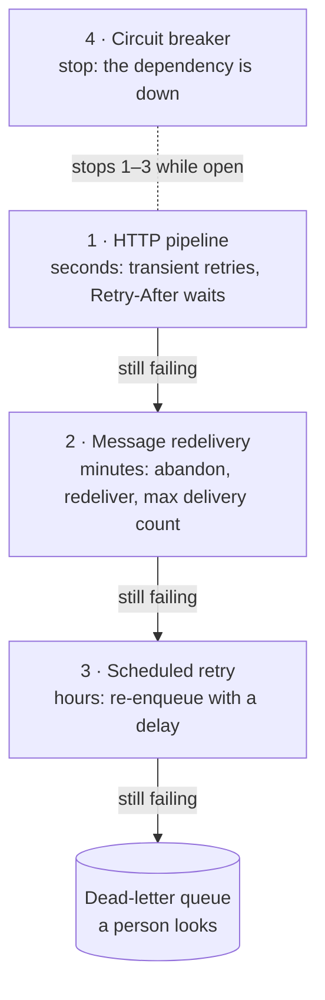

# Layered retries

An HTTP retry is one layer. A background worker usually has more: the message broker redelivers, a
scheduler tries again later, a circuit breaker stops trying altogether. Each layer is good at a
different time scale. Stack them carelessly and one failed call becomes dozens of attempts on a
dependency that is already struggling.

## The layers

| Layer | Time scale | Handles | Owned by |
|---|---|---|---|
| HTTP pipeline | seconds | a dropped connection, a restarting pod, a 429 with a short `Retry-After` | this library |
| Message redelivery | minutes | a dependency that is down for a few minutes | the broker: abandon, and let `MaxDeliveryCount` (for example 5) decide |
| Scheduled retry | hours | a maintenance window, a partner that is down for the afternoon | your code: re-enqueue with a scheduled time, or a retry topic |
| Circuit breaker | until it recovers | a dependency that is down: stop *all* callers from trying | see the [circuit breaker playbook](https://github.com/iverburgh/azure-functions-circuit-breaker-playbook) |
| Dead-letter queue | — | a message no retry will fix | a person |

## Rules

**Keep the HTTP layer short.** A message handler holds a lock on its message. An HTTP pipeline that
retries for nine minutes inside a five-minute lock loses the lock, the message is delivered again
elsewhere, and now two workers call the dependency for the same message. Set the
[total timeout](timeouts.md) well below the lock duration, and leave the long waits to the broker.

**Classify the error, then choose the layer.** After the HTTP pipeline gives up, decide:

| Outcome | Next |
|---|---|
| a transient failure that survived the HTTP retries | abandon: let the broker redeliver |
| throttling exhausted (`IsThrottleExhausted()` or `OutboundThrottleRejectedException`) | abandon, or schedule after `RetryAfter`; never dead-letter |
| a 4xx that the dependency documents as permanent | dead-letter at once: no retry will fix the request |
| a 4xx that this dependency is known to return transiently | abandon — see [non-idempotent partners](transient-retries.md#when-a-partner-is-not-idempotent-and-fails-transiently) |
| the circuit is open | do not even receive: stop the consumer |

A marker interface on your exceptions (`IRetryableError`, say) keeps that decision in one place: retryable
errors abandon, everything else dead-letters.

**Count attempts across layers.** Three HTTP attempts × five deliveries × three scheduled retries is
45 calls for one message. That can be fine — spread over hours — but know the number, and make sure the
dependency can take it when *every* message does it at once.

**Do not retry inside orchestrations.** A workflow engine that persists every step (Durable Functions,
for example) replays the orchestration on every await. Put retries in the activity's HTTP pipeline and
in the broker, not in orchestration-level retry loops that multiply with each replay and keep the
instance alive for hours.

## Slow is the new down

A dependency that answers in 13 seconds instead of 300 milliseconds does not fail a single call, and
no retry triggers. But a worker pool sized for fast calls is soon entirely waiting on it, and messages
for every *other* dependency stop being processed.

Two defences, best together:

1. a tight [attempt timeout](timeouts.md#attempt-timeout), so a slow call becomes a failure the layers
   above can handle;
2. a [concurrency limit](rate-limit-rules.md#concurrency-with-a-queue-the-bulkhead) per dependency, so
   it can only ever occupy its own share of the workers. Partitioning the work per dependency — a
   session or a subscription per partner — achieves the same at the broker.

## Tests

Retry layers multiply in tests too. In test fixtures, set `MaxRetryAttempts = 0` (or `BaseDelay = 0`)
for the HTTP layer and a delivery count of 1 for the broker, unless retrying is the behaviour under test.
See [testing](testing.md#testing-your-own-code).
