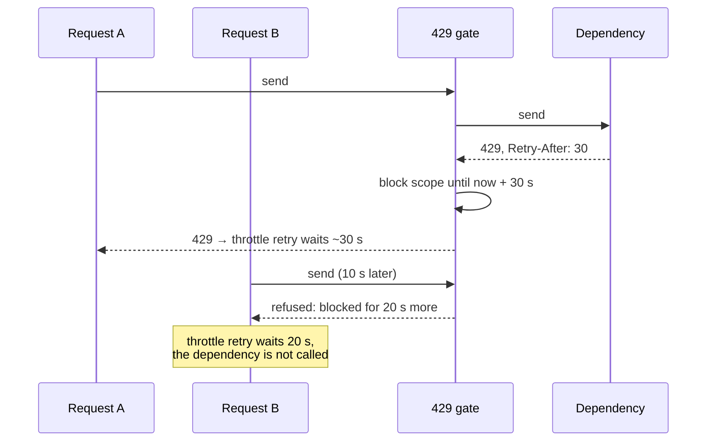

# Throttling and Retry-After

A 429 is not a failure. It is the dependency telling you how fast you may go, and usually *when* to come
back. Treating it like a 503 — exponential backoff from 2 seconds — means retrying long before the
server is ready, collecting another 429 each time, and spending the transient retries on something that
was never transient.

So throttling has its own retry, its own budget and its own clock.

## The throttle retry

| Setting | Default | Meaning |
|---|---|---|
| `ThrottleRetry.MaxRetryAttempts` | 3 | retries after a 429 or a local rejection; 0 returns the first 429 |
| `ThrottleRetry.DefaultRetryAfter` | 60 s | wait when the response has no usable `Retry-After` |
| `ThrottleRetry.MaxRetryAfter` | 120 s | cap on any single wait |

The wait comes from the response, not from a backoff formula:

| `Retry-After` | Wait |
|---|---|
| `Retry-After: 5` | 5 s |
| `Retry-After: Wed, 01 Jan 2031 12:00:30 GMT` | the time until then; 0 if it is in the past |
| missing or unreadable | `DefaultRetryAfter` |
| anything above `MaxRetryAfter` | `MaxRetryAfter` |

Then jitter is **added**: 0–10% of the wait, at least a 100 ms range. Only added, never subtracted —
a retry before the moment the server named is a wasted request and often a fresh 429. Code:
[RetryAfter.cs](../src/HttpResilience/Throttling/RetryAfter.cs),
[ThrottleRetry.cs](../src/HttpResilience/Strategies/ThrottleRetry.cs).

The cap matters: a misconfigured server answering `Retry-After: 3600` would otherwise park your caller
for an hour. With the cap, it waits two minutes, tries again, and eventually gives up with a clear 429.

### A 429 is retried for every method

Unlike the [transient retry](transient-retries.md#idempotency), the throttle retry also retries a
`POST`. A 429 means the request was refused, not processed. That is what the status code is for, and
what every rate limiter in front of an API does. If a dependency answers 429 *after* doing the work,
that is a bug in the dependency; set `ThrottleRetry.MaxRetryAttempts = 0` for that client and handle
the 429 yourself.

## The shared 429 gate

Without coordination, a 429 teaches one request. The next fifty requests to the same API, already in
flight or about to start, each collect their own 429 — and each of those counts against your quota at
many APIs.

The gate remembers the 429 for the scope it was received on:



A refused request becomes an `OutboundThrottleRejectedException` with `Reason = ServerThrottle` and the
remaining time as `RetryAfter`, which the throttle retry waits out. The dependency is not called.

- The block is stored **without jitter**: it is the server's moment. Each waiting request adds its own
  jitter on top, so they do not all return in the same millisecond.
- The scope is the host plus the path prefix of the matching [rule](rate-limit-rules.md): a 429 on
  `/orders` does not block `/catalog` when both have their own rule. Without rules, the scope is the
  whole host.
- A block is only ever extended, never shortened, so an old 429 arriving late cannot unblock early.
- The block is shared by every client in the process — and with the
  [Redis store](distributed-throttling-with-redis.md), by every instance.

Code: [ThrottleGateStrategy.cs](../src/HttpResilience/Strategies/ThrottleGateStrategy.cs).

## When throttling gives up

When the throttle retries run out, the last outcome goes to the caller:

- a **429 response** from the dependency, or
- an **`OutboundThrottleRejectedException`** when the gate or the limiter refused the last attempt.

Either way the request is marked: `request.IsThrottleExhausted()` returns `true`, the
`resilience.http.rejected_requests` counter goes up once with `rejection.reason` = `server_429` or
`rate_limit`, and event 4 is logged. The transient retry does not retry it.

```csharp
try
{
    using var response = await client.SendAsync(request, cancellationToken);
    if (response.StatusCode == HttpStatusCode.TooManyRequests)
    {
        return Defer(response.Headers.RetryAfter?.Delta);
    }
    // ...
}
catch (OutboundThrottleRejectedException ex)
{
    return Defer(ex.RetryAfter);   // the dependency was not called for the last attempt
}
```

A background worker should not fail the message here, but give it back for later: see
[layered retries](layered-retries.md).

## Throttling only

`AddOutboundThrottling()` adds just the throttle part — marker, throttle retry, gate and limiter — for a
client that keeps its own timeouts and transient retries but must still respect shared limits. Its
options are a named `ThrottleRetryOptions`:

```csharp
builder.Services.Configure<ThrottleRetryOptions>("legacy", builder.Configuration.GetSection("Legacy:Throttle"));
builder.Services.AddHttpClient("legacy").AddOutboundThrottling();
```

Mind [its `HttpClient.Timeout`](timeouts.md#the-throttling-only-pipeline).

Tested in [ThrottleRetryTests and SharedThrottleGateTests](../tests/HttpResilience.Tests/Pipeline/PipelineTests.cs).
